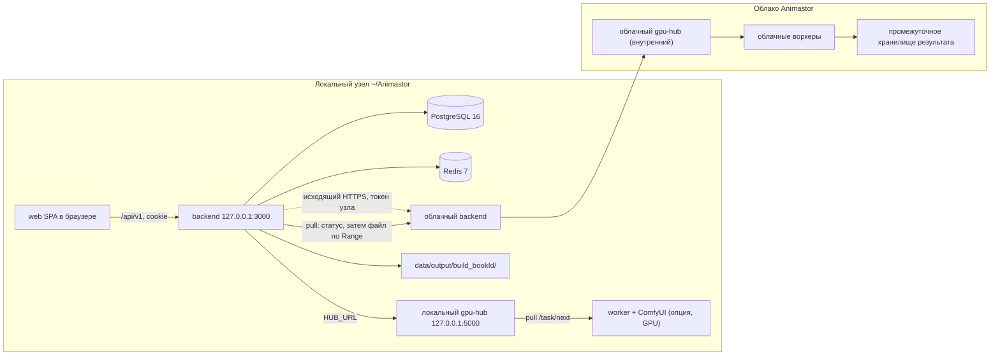

# Локальный узел Animastor — архитектура

> **Статус:** проект, кода в этом документе нет.
> **Ветка:** `design/local-node`, рабочее дерево `work/docs-local-node`, база — `main`.
> **Дата:** 2026-10-31.
> **Вход:** `research/local-install/01-recon.md` (ветка `recon/local-install`),
> `architecture/LINUX_INSTALLER_RECONNAISSANCE.md`,
> `04-planning/INSTALLER_ARCHITECTURE.md`, пакет `@animastor/installer`,
> код `animastor-backend`, `animastor-gpu-hub`, `animastor-worker`.
>
> **Соглашения.** Факт — ссылка `путь:строка` относительно корня `src/`
> (например, `animastor-backend/backend/src/backend.cjs:331`). Всё, что не
> подтверждено кодом или командой, помечено **ПРЕДПОЛОЖЕНИЕ**. Секреты,
> значения `.env` и адреса прода в документ не переносятся.

---

## 0. Резюме

**Гипотеза подтверждается частично.**

1. **Ретранслятор — облачный backend API, а не облачный hub напрямую.**
   Подтверждено: `POST /task` в hub защищён одним общим секретом
   `GPU_HUB_API_KEY` (`animastor-gpu-hub/gpu-hub.js:304-318`, `:767`), который
   backend отправляет заголовком `x-api-key`
   (`animastor-backend/backend/src/runtime/gpu-dispatcher.js:485-486`). В hub
   нет ни регистрации узла, ни токена на пользователя или узел для постановки
   задачи; `workspace_id` авторитетно вычисляет backend, hub проверяет только
   форму (`gpu-hub.js:804-820`). Отдавать этот ключ на клиентский узел нельзя,
   поэтому точка входа для узла — облачный backend.

2. **Маршрут «узел → облачный backend → облачный hub → облачные воркеры»
   правильный, но облачная сторона не должна выполнять обычный пайплайн книги.**
   Сейчас результат проходит через `task-handler` и пишется в
   `OUTPUT_DIR/<build_id>/<filename>` с обновлением `scene_assets` и FSM
   (`animastor-backend/backend/src/services/task-handler.cjs:283-336`,
   `animastor-backend/backend/src/storage/filesystem-store.js:98-127`). Если
   локальная книга не существует в облачной PG, этот пайплайн упадёт на
   `book_id`/`build_id`/`scene_assets`. Следовательно, облачный ретранслятор —
   **транспортно-промежуточный сервис** (приём задания, выполнение через hub,
   хранение файла, выдача узлу), а не вторая книга в облаке.

3. **Основной способ доставки — pull узлом (исходящие соединения), а не push
   облака на узел.** Это совпадает с решением владельца «облако не достаёт узел
   за NAT». Прямая доставка результата на узел (§5.9) остаётся опцией для
   продвинутых и не входит в первую версию.

4. **Риск прода по лимиту 50 MB существует, но он латентный, а не
   подтверждённый инцидентами.** `express.json({ limit: '50mb' })`
   (`animastor-backend/backend/src/backend.cjs:331`) при base64 даёт потолок
   ~37,5 MB бинарного файла, тогда как hub принимает до 500 MB
   (`animastor-gpu-hub/gpu-hub.js:298`). Подробности и предложение — §11.

**Что основное, что опция.** Основное — локальный стек в `~/Animastor/` и
облачный pull-ретранслятор с промежуточным хранением. Опция для продвинутых —
прямая доставка через исходящий туннель (`Cloudflare Tunnel` или `Tailscale`),
без port-forward, STUN и TURN. Обоснование — §5.9.

### 0.1. Сверка с разведкой

| Утверждение разведки | Факт на 2026-10-31 | Что делать в проекте |
|---|---|---|
| `@animastor/installer` v0.1.1 | `0.2.2` (`animastor-backend/packages/animastor-installer/package.json:3`) | считать 0.2.2 |
| Лимит backend `50mb`, `backend.cjs:331` | подтверждено (`backend.cjs:331`) | использовать эту ссылку; в `JOB_PROTOCOL_V2.md:513` ссылка `:91` устарела |
| Лимит hub `500mb`, `gpu-hub.js:298` | подтверждено | — |
| `build_<id>` | для AI-книги `build_id = build_${bookId}` (`animastor-backend/packages/animastor-vbook-runtime/src/lazy-book/draft.js:36`); ручная правка — `manual_<timestamp>` (`animastor-backend/packages/animastor-editor/src/entity-crud-routes.cjs:712`) | `build_id` не уникален для запуска; идемпотентность строить на `dispatch_id` |
| Pull-эндпоинта результата нет | подтверждено: есть только `POST /task/result` (`gpu-hub.js:1088`) и колбэк в backend (`gpu-hub.js:1189`) | добавить pull на облачном ретрансляторе |
| `ghcr.io/animastor/*` можно тянуть | **не подтверждено:** анонимный token endpoint вернул `401 UNAUTHORIZED`, manifest — `403` (проверка 2026-10-31) | не строить установку на анонимном pull; собирать локально или требовать авторизацию |
| `HUB_URL` по умолчанию `https://animastor.org/gpu` | подтверждено (`runtime-config.js:82`, `worker.cjs:28`) | локально переопределять на `http://127.0.0.1:5000` |
| Веб-статику backend не отдаёт | подтверждено: единственный поток файла — экспорт (`animastor-backend/backend/src/routes/book/export-routes.cjs:41`), `express.static` нет | добавить отдачу SPA в backend (§8) |

---

## 1. Топология

### 1.1. Локальный стек



Локально работают: `postgres`, `redis`, `backend`, `gpu-hub`, статика web,
опционально `worker` + `ComfyUI`. Локальный `gpu-hub` нужен только если есть
локальный GPU: worker не умеет обходить hub — он опрашивает `HUB_URL/task/next`
и шлёт бекон на `HUB_URL/beacon`
(`animastor-worker/packages/animastor-worker/worker/worker.cjs:228`, `:259`).

### 1.2. Связь с облаком

Все соединения инициирует узел:

- `POST` задания в облачный backend по токену узла;
- `GET` статуса задания (обычный или длинный poll);
- `GET` файла результата с `Range` для докачки;
- `POST` подтверждения получения (нужен для TTL и учёта).

Облако не открывает соединение к узлу. Облачный `gpu-hub` остаётся внутренним:
его `x-api-key` не покидает облако (`gpu-hub.js:304-318`).

### 1.3. Что остаётся без изменений

- `worker.cjs` не меняется: локальный worker смотрит на локальный hub.
- `gpu-hub` не меняется для первой версии: он по-прежнему принимает задачи
  только от backend по общему ключу.
- `task-handler` и `filesystem-store` переиспользуются для приёма облачного
  результата на локальной стороне: файл кладётся в
  `OUTPUT_DIR/<build_id>/<filename>`, FSM и `scene_assets` обновляются как при
  локальной генерации.

---

## 2. Упаковка

### 2.1. Сравнение

| Критерий | Docker compose | Нативно (Node + PG + Redis) |
|---|---|---|
| Root | нужен docker daemon или настройка без root (`newuidmap`, `subuid`) | после установки пакетов root не нужен; процессы — пользовательские |
| Образы | backend/gpu-hub только из GHCR; анонимный pull не проходит (см. §0.1) — нужна сборка или авторизация | образы не нужны, запуск `node src/backend.cjs` |
| Диск | слои образов + тома; данные Docker без root по умолчанию вне `~/Animastor` | один каталог `~/Animastor`, без слоёв |
| Обновление | пересборка/перепин дайджеста, перезапуск контейнеров | распаковка релиза в `app/releases/<ver>`, переключение симлинка, миграции при старте |
| Удаление | контейнеры, тома, сети, образы; часть следов в docker | удаление каталога и пользовательских unit-файлов |
| Изоляция | выше | ниже (общий Node/PG на пользователя) |
| Повторяемость | выше (фиксация версий образов) | ниже, но версии фиксируются манифестом установщика |

### 2.2. Рекомендация

**Нативная установка как основная, Docker compose — как опция для тех, у кого
docker уже настроен.**

Причины:

1. Анонимный pull образов не работает; строить «одну команду» на приватном
   registry нельзя без авторизации.
2. Нативный запуск уже существует и не требует сборки:
   `node src/backend.cjs` (`animastor-backend/backend/package.json:8`),
   `node server.js` у hub, `node worker.cjs` у worker.
3. `ffmpeg` всё равно нужен на хосте: он вызывается из backend
   (`animastor-backend/backend/src/audio/ffmpeg.js:9`,
   `animastor-backend/backend/src/video/video-merge.js:58`), а в образе
   ставится через `apt` (`animastor-backend/backend/Dockerfile:3`). Для
   локального GPU `ComfyUI` и модели уже живут нативно — контейнер не даёт
   выигрыша.
4. Удаление «без следов» проще: пользовательские unit-файлы и каталог
   `~/Animastor`, без docker-слоёв и внешних томов.

**Пользовательские экземпляры PG и Redis.** `initdb` и `redis-server`
запускаются от пользователя с данными в `~/Animastor/data/pg` и
`~/Animastor/data/redis`, порты слушают только `127.0.0.1`. Это убирает
системные сервисы и root после установки бинарников. **ПРЕДПОЛОЖЕНИЕ:**
пакеты `postgresql-16` и `redis-server` доступны в целевых дистрибутивах;
иначе установщик кладёт переносимые сборки в `app/vendor/`.

**Docker compose (опция).** Только с локальной сборкой backend
(`animastor-backend/backend/Dockerfile`) и публичными `postgres:16`/`redis:7`;
данные — монтирование каталогов в `~/Animastor/data`. Docker без root с
`--data-root ~/Animastor/docker`. Эта опция не входит в первую веху.

### 2.3. Раскладка `~/Animastor/`

```text
~/Animastor/
├── app/
│   ├── releases/<version>/        # backend, gpu-hub, web/dist, package.json
│   └── current -> releases/<version>
├── data/
│   ├── books/                     # BOOKS_DIR
│   ├── output/                    # OUTPUT_DIR, подкаталоги build_<bookId>/
│   ├── pg/                        # initdb
│   └── redis/                     # dump.rdb / appendonly
├── config/
│   ├── node.json                  # маршрутизация по умолчанию, лимиты
│   └── install-state.json         # что создал установщик (для uninstall)
├── secrets/
│   ├── backend.env                # 0600
│   └── node-token                 # 0600, появляется после регистрации узла
├── logs/
├── worker/                        # опция: bundle @animastor/worker-dev
├── ComfyUI/                       # опция: managed
│   └── (или симлинк на существующий ~/ComfyUI)
└── bin/animastor                  # CLI управления
```

`app/current` — единственная точка, на которую смотрят unit-файлы. Откат —
переключение симлинка на предыдущий релиз.

---

## 3. Установка одной командой

### 3.1. Шаги

1. **Проверка системы.** `x86_64`/`aarch64`, `glibc`, Node ≥ 20
   (`animastor-backend/packages/animastor-installer/package.json:25`), свободное
   место (≥ 5 GB без GPU, ≥ 50 GB с видео-профилем), свободные порты 3000 и
   5000, наличие `ffmpeg`/`ffprobe`, опционально `nvidia-smi`.
2. **Раскладка и секреты.** Создать каталоги из §2.3, сгенерировать
   `WORKSPACE_SECRET_KEY`, `GPU_HUB_API_KEY`, пароль роли PG. Пароль
   суперпользователя PG не нужен: `initdb` делает пользователя-владельца.
3. **PostgreSQL.** `initdb -D ~/Animastor/data/pg`, роль приложения и БД,
   пароль роли — из сгенерированного секрета. Миграции запускает сам backend
   при старте (`animastor-backend/backend/src/backend.cjs:839`).
4. **Redis.** Пользовательский экземпляр, `bind 127.0.0.1`, без внешнего
   доступа; персистентность — на усмотрение установщика (для очередей и
   результатов достаточно эфемерного режима, но потеря результатов при
   рестарте нежелательна).
5. **backend.** `DATA_ROOT=~/Animastor/data`, `HUB_URL=http://127.0.0.1:5000`,
   `COOKIE_DOMAIN` пустой, `PORT=3000`, `GPU_HUB_API_KEY` — тот же, что у hub.
6. **gpu-hub.** `REDIS_URL=redis://127.0.0.1:6379`, `BACKEND_URL=http://127.0.0.1:3000`,
   `GPU_HUB_API_KEY`, `PORT=5000`, слушать только loopback.
7. **web.** Собранный `dist` кладётся в `app/current/web`; отдаётся backend
   (новый middleware, §8) либо локальным nginx. Резервная отдача `index.html`.
8. **Первый пользователь.** Регистрация через UI (`POST /api/v1/auth/register`,
   `animastor-backend/backend/src/routes/auth-routes.cjs`); режим —
   однопользовательский, гостевые рабочие пространства можно оставить
   выключенными.
9. **Запуск.** Пользовательские unit-файлы `systemd --user`:
   `animastor-backend.service`, `animastor-hub.service`, `animastor-pg.service`,
   `animastor-redis.service`, опционально `animastor-worker.service`.
10. **Проверка.** Процессы живы, `GET /health` у hub отвечает, вход в web
    работает, `GET /api/v1/health` (или существующий эндпоинт проверки
    состояния backend) отвечает, каталоги `books`/`output` доступны на запись.

### 3.2. Секреты

| Секрет | Кто генерирует | Где хранится | Замечание |
|---|---|---|---|
| `WORKSPACE_SECRET_KEY` | установщик | `secrets/backend.env`, 0600 | AES-256-GCM для ключей рабочих пространств; обязателен |
| `GPU_HUB_API_KEY` | установщик | `secrets/backend.env`, 0600 | общий секрет backend ↔ hub; fail-closed в hub |
| пароль роли PG | установщик | `secrets/backend.env`, 0600 | не пароль суперпользователя |
| токен узла | облачный backend | `secrets/node-token`, 0600 | выдаётся один раз при регистрации узла |
| `HF_TOKEN` | пользователь | `secrets/backend.env` или env | только для gated-моделей, не логируется |

Сессионного `SESSION_SECRET` нет: токен сессии — `sid.<id>.<secret>`, в PG
хранится SHA-256 секрета (`animastor-backend/backend/src/storage/postgres/repositories/session-repo.js:15-31`).

### 3.3. Локальный режим

- `COOKIE_DOMAIN` пустой → cookie host-only, без `Domain`
  (`animastor-backend/packages/animastor-auth/src/cookies.js:33-36`).
- `Secure` выставляется только при HTTPS (`routes/auth-routes.cjs:39`,
  `cookies.js:33-36`); на `http://localhost` cookie работает.
- `SameSite=Lax`, `HttpOnly`, `Path=/` — уже в cookie
  (`cookies.js:9`, `:36`).
- Web и API на одном origin (`http://localhost:3000`) — не нужны CORS и
  отдельный прокси; `/gpu` браузеру не нужен, с hub общается только backend.
- Если позже понадобится доступ из LAN, добавляется TLS-терминатор (nginx или
  Caddy) и `COOKIE_DOMAIN` остаётся пустым; `Secure` включится по HTTPS.

---

## 4. Маршрутизация по слоям

### 4.1. Где принимается решение

**Слой:** локальный backend, `runtime/gpu-dispatcher.js`, в момент отправки
задания. Не web и не hub.

Сейчас dispatcher уже решает, в какую очередь отправить задание, и проверяет
живого исполнителя: `hasLiveExecutorForLane`
(`animastor-backend/backend/src/runtime/gpu-dispatcher.js:258-278`). Новое
решение `target = local | cloud` добавляется **до** выбора очереди:

1. Если книга закреплена за облаком — `cloud`.
2. Иначе если для типа задания есть живой локальный worker — `local`.
3. Иначе — `cloud` (если узел зарегистрирован и включён облачный режим).
4. Если облако недоступно — задание остаётся в очереди с причиной
   `cloud_unavailable`, а не падает.

**Модель:** в первой версии маршрутизация только по типу задания и живости
исполнителя. Фильтра по модели/VRAM нет: в манифестах установщика
`hardware.gpu_min_vram_gb: null` (`LINUX_INSTALLER_RECONNAISSANCE.md`, §1.6,
§10), а hub сверяет только `worker_type` (`gpu-hub.js:909`). Маршрутизация по
модели — после появления каталога моделей и поля VRAM.

### 4.2. Где хранится настройка

| Уровень | Где | Что |
|---|---|---|
| Узел | `config/node.json` | режим по умолчанию: `local-first`, `cloud-only`, `local-only`; адрес облака; лимиты |
| Книга | `book.json` → `manifest.generation.target` | переносимая настройка вместе с `.vbook`; `auto` по умолчанию |
| Задание | `generation_tasks.metadata` | фактический `target`, `worker_id`, причина выбора |

Настройка книги переносится в `.vbook`; настройка узла — нет. Это позволяет
открыть книгу на другом узле и получить то же поведение, но не тащить чужие
лимиты.

### 4.3. Что видит пользователь

- Бейдж у книги/задания: «локально» или «облако».
- Переключатель на книге: «авто / только локально / только облако».
- Одинаковый прогресс (SSE) и одинаковые ошибки; для облака дополнительно
  показывается «в очереди облака» и «скачивание результата».
- Причина, по которой выбрано облако: нет локального GPU, книга закреплена,
  локальный worker не в сети.

---

## 5. Протокол узел ↔ облако

### 5.1. Регистрация узла и токен

- Пользователь в web (облачный аккаунт или локальный, если он привязан к
  аккаунту) создаёт узел: `POST /api/v1/nodes`.
- Облачный backend возвращает токен **один раз**: предлагается формат
  `nod.<node_id_b64url>.<secret_b64url>`; в PG хранится SHA-256 секрета, как у
  сессий (`session-repo.js:15-31`) и Private Workers (`workers.token_hash`,
  `animastor-backend/backend/src/storage/postgres/schema.js:263-284`).
- Токен привязан к `workspace_id` и `node_id`; отзыв — `DELETE /api/v1/nodes/:id`,
  ротация — `POST /api/v1/nodes/:id/rotate`.
- Узел не получает `GPU_HUB_API_KEY` и не обращается к hub.

### 5.2. Постановка задачи

`POST /api/v1/node/jobs` с `Authorization: Bearer nod...`.

Тело (минимум):

```json
{
  "dispatch_id": "uuid",
  "job_id": "bookId_chapterId_sceneId_chunkIndex:type",
  "job_type": "audio|image|video",
  "build_id": "build_<bookId>",
  "book_id": "...",
  "chapter_id": "...",
  "scene_id": "...",
  "stage": "audio|image|video",
  "params": { },
  "assets": { "image": "<base64>" },
  "timeout_ms": 600000
}
```

Требования:

- `dispatch_id` — идемпотентный ключ попытки, генерируется локальным backend.
- `build_id` — локальный, не создаёт книгу в облаке; облако использует его
  только как часть ключа хранения и для возврата имени файла.
-  `assets` — входные изображения для видео. В первой версии допустим base64
  (как в hub, `gpu-hub.js:826-832`), но с жёстким лимитом; предпочтительнее
  multipart/поток, чтобы не держать мегабайты в JSON.
- Облачный backend проверяет, что `job_type` разрешён узлу и что `build_id`
  принадлежит этому узлу (по ранее заявленным книгам или по префиксу книги,
  которую узел синхронизировал).

Облачный backend ставит задачу в облачный hub тем же способом, что и сейчас:
`POST /task` с `x-api-key` (`gpu-dispatcher.js:485-486`, `gpu-hub.js:767`), с
`workspace_id`, вычисленным на облачной стороне.

### 5.3. Статус (pull)

- `GET /api/v1/node/jobs/{dispatch_id}` → `{state, progress, error, artifact}`.
- `state`: `queued | running | completed | failed | expired`.
- Длинный опрос до 25 с или SSE; интервал опроса — 2–5 с, с нарастающей
  паузой.
- Узел никогда не слушает входящие соединения.

### 5.4. Скачивание артефакта (Range, докачка)

- `GET /api/v1/node/jobs/{dispatch_id}/artifact` с заголовком `Range`.
- Ответы: `200` (полный файл), `206` (часть), `416` (некорректный диапазон),
  `404` (истёк TTL), `409` (файл ещё не готов).
- Заголовки: `Content-Length`, `Content-Range`, `Accept-Ranges: bytes`,
  `ETag` = SHA-256 файла, `Content-Type` по расширению.
- Узел докачивает по `Range` и сверяет SHA-256; при несовпадении — повтор с
  нуля, не более N раз.
- В backend сейчас нет `Range` для выдачи артефактов: единственный поток
  файла — экспорт книги без диапазонов
  (`animastor-backend/backend/src/routes/book/export-routes.cjs:41`). Новый
  маршрут реализуется отдельно.

### 5.5. Хранение и TTL на облаке

- Файл результата кладётся в промежуточную зону:
  `OUTPUT_DIR/_relay/<node_id>/<dispatch_id>/<filename>`.
- TTL по умолчанию — 48 ч, как `BUILD_TTL_HOURS`
  (`animastor-backend/backend/src/backend.cjs:299`); для ретранслятора
  достаточно 24–72 ч, настраивается.
- После `POST /api/v1/node/jobs/{dispatch_id}/ack` (подтверждение получения)
  файл удаляется сразу.
- Периодическая очистка — отдельная задача, а не `cleanup-service` книги:
  `cleanup-service` работает с каталогами сборок книги и не знает про
  `_relay`.
- В hub результат живёт в Redis 1 ч (`gpu-hub.js:1140-1146`); это не хранилище
  для узла, а буфер восстановления.

### 5.6. Квоты и учёт (минимум первой версии)

- Ограничение одновременных заданий на узел: 1–2 (по типу), чтобы не
  забивать облачную очередь.
- Ограничение размера входных `assets` и результата.
- Суточный лимит заданий и байт на узел.
- Учёт: `node_id`, `workspace_id`, `job_type`, `bytes_in`, `bytes_out`,
  `duration_ms`, `state`. Этого достаточно для диагностики и будущей
  тарификации; биллинга в первой версии нет.
- Квоты backend уже существуют как слоты concurrency:
  `MAX_ACTIVE_AUDIO=8`, `MAX_ACTIVE_IMAGE=4`, `MAX_ACTIVE_VIDEO=2`
  (`animastor-backend/backend/src/config/runtime-config.js:149-153`); для узла
  они не заменяют собственный лимит.

### 5.7. Идемпотентность и повторы

- `dispatch_id` уникален; повторный `POST` с тем же `dispatch_id` возвращает
  существующее задание, а не создаёт второе.
- Результат дедуплицируется по `dispatch_id` + `job_id` + `build_id` —
  по образцу `animastor:result-processed:...`
  (`animastor-backend/backend/src/routes/generation-routes.cjs:495-506`).
- Потеря ответа узлом: узел повторяет `POST` с тем же `dispatch_id`.
- Потеря соединения при скачивании: `Range` продолжает с последнего байта.
- Ошибка облачного задания: узел получает `failed` с кодом; повтор — новый
  `dispatch_id`, если пользователь явно перезапустил.
- `build_id` не годится как ключ идемпотентности: он равен `build_<bookId>`
  (`draft.js:36`) и одинаков для всех запусков книги.

### 5.8. Связь с `build_<id>` и `artifact-naming`

- Имя файла задаёт локальная сторона по канонической грамматике:
  `{bookId}_{chapterId}_{sceneId}.mp3|.mp4|.png`,
  чанки `{prefix}_{NNNN}.mp3`, группы `{prefix}_gN.mp4`, превью
  `{prefix}_pr{id}.png`
  (`animastor-backend/packages/animastor-generation/src/core/artifact-naming.js:37-80`).
- Облако не переименовывает файл: оно хранит его под `dispatch_id` и
  возвращает исходное имя и SHA-256.
- Локальный приём вызывает существующий `task-handler`/`filesystem-store` с
  локальным `build_id`, поэтому файл попадает в
  `OUTPUT_DIR/<build_id>/<filename>` и FSM обновляется как обычно
  (`task-handler.cjs:283-336`, `filesystem-store.js:98-127`).
- `build_id` в облаке не создаёт записей `scene_assets`; это делает локальный
  backend после скачивания.

### 5.9. Связь с существующими Private Workers

Private Worker — это GPU пользователя, который пулит **облачную** очередь
своего workspace: регистрация в Settings → Private Workers, токен `wrk.*`,
очередь `queue:{type}:ws:{workspace}` (`gpu-hub.js:895-958`;
`animastor-backend/backend/src/routes/worker-setup-routes.cjs:8-14`). Это
NAT-дружелюбная схема: worker сам инициирует соединения к облачному hub.

Для локального узла это **другой** режим:

| | Private Worker | Локальный узел |
|---|---|---|
| Куда пулит | облачный hub | локальный hub |
| Чья очередь | облачный workspace | локальная книга |
| Куда результат | облачный backend по колбэку | локальный backend |
| Нужен публичный URL | нет (колбэк делает hub) | нет (узел скачивает pull) |

Смешивать их в первой версии нельзя: локальный worker не должен получать
облачные задания, иначе результат уйдёт в облако, а локальная книга его не
увидит. Опция «локальный GPU как облачный Private Worker» возможна позже, но
тогда облако должно вернуть файл узлу через pull, а не через колбэк.

### 5.10. Альтернатива: облачный worker доставляет результат прямо на узел

Это ответ на вопрос «rendezvous-сервер, STUN/TURN, Cloudflare Tunnel или
Tailscale вместо pull через облачный backend».

#### 5.10.1. Что означает «прямо» при CGNAT

Домашний провайдер почти всегда даёт CGNAT: узел не имеет публичного адреса,
входящие соединения невозможны, а исходящий NAT-маппинг непредсказуем.
Следствия:

- **Проброс порта (port-forward) и UPnP не работают.** Публичного адреса нет; UPnP на
  CGNAT-роутере либо выключен, либо открывает порт только до провайдерского
  NAT, а не до интернета.
- **STUN даёт только внешний адрес и порт**, но не гарантирует проходимость.
  Пробивка UDP требует одновременного исходящего пакета с обеих сторон и координации через rendezvous-сервер. При симметричном NAT и
  CGNAT (разные маппинги на разные адресаты) пробивка часто не срабатывает.
- **TURN — это уже ретранслятор.** Если punching не удался, трафик идёт через
  TURN-сервер, то есть через облако. Выигрыша перед pull нет, а сложности и
  стоимость выше.
- **IPv6 не спасает:** он есть не у всех, а провайдерский firewall и CGNAT
  для IPv4 остаются.

Вывод: «прямая доставка» в чистом виде (P2P между облачным worker и узлом)
для массового домашнего пользователя ненадёжна. Реалистичные варианты —
исходящий туннель с узла.

#### 5.10.2. Варианты

| Вариант | Как работает | CGNAT | Публичный доступ | Сложность |
|---|---|---|---|---|
| Port-forward / UPnP | узел открывает порт | не работает | да, если есть белый IP | низкая, но неприменима |
| STUN + пробивка UDP | обмен адресами, пробивка UDP | часто не работает | нет | высокая |
| TURN | ретрансляция через сервер | работает | нет | высокая, трафик через сервер |
| Cloudflare Tunnel | `cloudflared` с узла держит исходящее соединение, облако даёт имя хоста | работает | да, публичное имя хоста | средняя: нужен домен в Cloudflare |
| Tailscale | WireGuard-меш, узел и облачный worker в одной сети Tailscale | работает | нет, приватная сеть | средняя: аккаунт, клиент на обеих сторонах, ACL |

#### 5.10.3. Безопасность

- **Публичное имя хоста Cloudflare Tunnel** видно сканерам. Нужен второй
  барьер: Cloudflare Access со служебным токеном, mTLS или подписанный
  одноразовый токен задания. Иначе любой, кто узнал URL, может пытаться писать на узел.
- **Tailscale** приватнее, но компрометация сети Tailscale = доступ ко всем
  узлам; нужны ACL, теги и отзыв устройств.
- **Аутентификация должна быть на уровне задания**, а не только на уровне
  сети: облачный worker предъявляет подписанный `dispatch_id`/`job_id`,
  узел проверяет подпись, срок и одноразовость.
- **Ограничение поверхности:** на узле слушает только приёмник результата,
  а не весь backend, не web и не hub.
- **Целостность:** SHA-256 файла в подписанном ответе, проверка на узле,
  запрет path traversal в имени файла, лимит размера.
- **Никаких долгоживущих общих секретов** в облачном worker; ключ узла —
  только для приёма, отзываемый.

#### 5.10.4. Надёжность

- Прямая доставка требует, чтобы узел был онлайн **в момент завершения**
  задания. Ноутбук уснул, домашний интернет моргнул, NAT пересоздал маппинг —
  результат теряется или повторяется.
- Нет хранения с отложенной выдачей: облако не может «подождать» узел.
- Pull с промежуточным хранением развязывает стороны: облако завершает
  задание, файл лежит до TTL, узел забирает когда может и докачивает.
- Для интерактивного превью прямая доставка может быть быстрее, но это не
  основной сценарий генерации книги.

#### 5.10.5. Сравнение с pull через облачный backend

| Критерий | Pull через облако (основное) | Прямая доставка (опция) |
|---|---|---|
| CGNAT | работает всегда | STUN часто нет; TURN/туннель — да |
| Исходящие соединения | только с узла | только с узла (туннель) или P2P |
| Узел не в сети | результат ждёт до TTL | задание не доставляется |
| Публичная поверхность | нет | имя хоста/порт/туннель |
| Аутентификация | токен узла + сессия | токен узла + подпись задания + сеть |
| Хранение на облаке | да, TTL | нет или временное |
| Стоимость | исходящий трафик + диск | TURN/туннель + сложность |
| Латентность | выше (poll + скачивание) | ниже |
| Сложность реализации | средняя | высокая |
| Соответствие решению владельца | да | частично (только через исходящий туннель) |

#### 5.10.6. Вывод

- **Основное:** pull через облачный backend с промежуточным хранением и
  докачкой. Это единственный вариант, который одинаково работает за CGNAT,
  переживает офлайн узла и не открывает узел в интернет.
- **Опция для продвинутых:** исходящий туннель (`Tailscale` предпочтительнее
  для приватности, `Cloudflare Tunnel` — если нужно публичное имя хоста),
  только для приёма результата, с подписанным заданием и жёсткими лимитами.
- **Не делать:** проброс порта, UPnP, чистый STUN/P2P как основной путь.
  TURN допустим только как резерв внутри будущего WebRTC-сценария, но он не
  даёт преимуществ перед pull для файлов.
- **Первая версия:** только pull. Прямая доставка — после этапа 3, как
  отдельный флаг `routing.direct_delivery=off` по умолчанию.

---

## 6. Запись в сборку: чем и как сгенерировано

### 6.1. Что есть сейчас

- `scene_assets` хранит `build_id`, `path`, `duration_sec`, `width`, `height`,
  `format`, `chunks`, `metadata` JSONB
  (`animastor-backend/backend/src/storage/postgres/schema.js:573-598`).
- `generation_tasks` хранит `task_id`, `worker_id`, `workspace_id`, `status`,
  `metadata` JSONB (`schema.js:235-253`).
- `workers` хранит `version`, `metadata`, `capabilities`
  (`schema.js:263-284`).
- Отдельных колонок `executor`, `model`, `workflow`, `workflow_version` нет.
- Имя файла не содержит модель или версию: грамматика
  `artifact-naming.js:37-80` фиксирует только книгу/главу/сцену/группу.

### 6.2. Предложение

При успешном результате писать в `scene_assets.metadata.generation` и
`generation_tasks.metadata.generation`:

```json
{
  "executor": "local|cloud",
  "worker_id": "...",
  "node_id": "...",
  "model": "ltx-2.3",
  "model_repo": "LTX-2.3-distilled-Q4_K_M.gguf",
  "workflow": "video-ltx-2p",
  "workflow_hash": "...",
  "profile": "ltx-2.3",
  "comfyui_version": "0.27.0",
  "seed": 123,
  "params_hash": "...",
  "created_at": "2026-10-31T00:00:00Z"
}
```

Это позволяет:

- показать в web, чем сгенерирован файл;
- перегенерировать выбранную сцену другой моделью, сохранив прежнюю версию;
- перенести книгу в `.vbook` вместе с историей генерации;
- отладить расхождение локального и облачного результата.

### 6.3. Для `.vbook` «перегенерировать любой моделью»

- В манифест `.vbook` (`book.json`) добавить `generation` на уровне сцены или
  отдельный `generation.json` рядом с ассетами.
- При импорте `.vbook` метаданные читаются, но не являются обязательными:
  старые книги открываются без них.
- Перегенерация создаёт новый `build_id`? Нет: `build_id` привязан к книге
  (`build_<bookId>`), поэтому версия результата должна храниться в
  `scene_assets` (несколько строк на `build_id` не предусмотрено уникальным
  ключом `UNIQUE(book_id, chapter_id, scene_id, asset_type, build_id)`).
  **ПРЕДПОЛОЖЕНИЕ:** для истории версий потребуется либо `generation_id` в
  ключе, либо отдельная таблица `artifact_versions`. В первой версии
  достаточно перезаписи с сохранением метаданных последней генерации.
- Это открытый вопрос владельцу (§10): нужна ли история версий или достаточно
  последней.

---

## 7. Обновление и удаление

### 7.1. Что есть сейчас

`@animastor/installer` 0.2.2 умеет `detect`, `plan`, `install`, `verify`,
`resume`, `uninstall`, а также `start`, `stop`, `status`, `logs`, `doctor`
(команда `animastor` в PATH)
(`animastor-backend/packages/animastor-installer/src/installer/cli.js:10-17`).
Команды `update` нет. `uninstall` учитывает владение и не удаляет чужое
(`cli.js:17`, `installer/uninstaller.js`).

### 7.2. `animastor update`

1. `GET` манифеста релиза (версия, SHA-256, совместимость схемы PG).
2. Скачать в `app/releases/<version>.tmp`, проверить SHA-256.
3. Остановить unit-файлы, распаковать, переключить `app/current`.
4. Запустить backend: миграции PG идемпотентны и выполняются при старте
   (`backend.cjs:839`, `schema.js:715`).
5. Проверить состояние; при ошибке вернуть симлинк на предыдущий релиз.
6. Данные, `config/`, `secrets/` не трогаются.

### 7.3. `animastor uninstall`

1. Остановить и удалить пользовательские unit-файлы.
2. Удалить `app/`, `bin/animastor`, логи.
3. Спросить про данные: `data/books`, `data/output`, `config/`, `secrets/`.
   По умолчанию **не удалять** книги и output; удалять только по явному
   `--purge`.
4. Не удалять `ComfyUI`, модели и custom nodes, если установщик их не создавал
   (правило владения из `uninstaller.js`).
5. Удалить запись узла в облаке (`DELETE /api/v1/nodes/:id`) по желанию.

---

## 8. Изменения по репозиториям

| Репозиторий | Изменение | Переиспользуется |
|---|---|---|
| `animastor-backend` | новый модуль `local-node` (CLI установки/обновления/удаления) на движке `@animastor/installer` | `engine/prereq`, `engine/state`, `engine/io`, `uninstaller` |
| `animastor-backend` | отдача SPA: `express.static` + резервная отдача `index.html` | `express`, helmet, текущий backend |
| `animastor-backend` | маршрутизация `target` в `gpu-dispatcher` | `hasLiveExecutorForLane`, очереди hub |
| `animastor-backend` | клиент облачного ретранслятора (submit/status/artifact/ack) | `fetch`, `job-schema`, `task-handler`, `filesystem-store` |
| `animastor-backend` | новый маршрут выдачи артефакта с `Range` | формат ответов экспорта |
| `animastor-backend` | метаданные генерации в `scene_assets`/`generation_tasks` | `metadata` JSONB, схема миграций |
| `animastor-backend` | серверные эндпоинты узла в облаке (`/api/v1/nodes`, `/node/jobs`) | auth, workspace, worker-подобная модель токена |
| `animastor-gpu-hub` | для первой версии — без изменений | `POST /task`, `/task/next`, `/task/result` |
| `animastor-gpu-hub` | опционально: бинарная загрузка результата вместо base64 (для §11) | `express.raw`/multer, Redis-буфер |
| `animastor-worker` | без изменений | `HUB_URL` уже настраивается |
| `animastor-web` | бейдж и переключатель «локально/облако», докачка | текущий API-клиент, SSE |
| `animastor-docs` | этот документ, CHANGELOG | — |
| новый пакет | `@animastor/local-node` внутри монорепо backend, не новый репозиторий в первой версии | установщик, контракты |

**Почему не новый репозиторий.** Установщик уже живёт в
`animastor-backend/packages/animastor-installer` и содержит движок проверок,
состояния и удаления. Новый пакет рядом переиспользует его без копирования.
Отдельный репозиторий оправдан только при независимом релизном цикле, которого
в первой версии нет.

---

## 9. Этапы

### Этап 1. Локальный стек без генерации

**Что:** установка одной командой, PG, Redis, backend, web-статика, вход,
импорт `.vbook`, редактор, экспорт, локальный hub без worker.

**Критерий готовности:**

- чистая Ubuntu, одна команда, вход в браузере `http://localhost:3000`;
- импорт `.vbook`, правка сцены, сохранение, перезапуск — данные на месте;
- `animastor update` и `animastor uninstall` не оставляют процессов и
  unit-файлов;
- секреты сгенерированы, `COOKIE_DOMAIN` пуст, cookie работает по HTTP.

**Объём:** средний (установщик, статика, unit-файлы, документация).
**Кому:** Claude Code.

### Этап 2. Локальный GPU через существующий установщик

**Что:** `@animastor/installer` ставит worker + ComfyUI, `HUB_URL` указывает на
локальный hub, аудио-сцена генерируется end-to-end, файл попадает в
`data/output/<build_id>/`.

**Критерий готовности:**

- `nvidia-smi` виден, worker онлайн в локальном hub;
- аудио-задание из web выполняется локально, прогресс и файл отображаются;
- повторный запуск установщика идемпотентен;
- при отсутствии GPU узел работает в режиме «только облако/редактор».

**Объём:** средний, в основном переиспользование установщика.
**Кому:** Claude Code + кодер (интеграция hub/worker).

### Этап 3. Облачный ретранслятор

**Что:** регистрация узла, токен, постановка задания, статус, скачивание с
докачкой, TTL, квоты, маршрутизация `local|cloud`, метаданные генерации.

**Критерий готовности:**

- узел без GPU отправляет видео-задание в облако и скачивает результат с
  обрывом соединения и успешной докачкой;
- повторный `POST` с тем же `dispatch_id` не создаёт дубль;
- истёкший TTL даёт понятную ошибку, а не битый файл;
- локальная книга и `scene_assets` обновляются после скачивания;
- в web видно, где выполнено задание.

**Объём:** большой (новый протокол, облачные маршруты, клиент, тесты).
**Кому:** Claude Code + backend-кодер.

**Первая веха:** этап 1.

---

## 10. Риски и открытые вопросы владельцу

### 10.1. Риски

| Риск | Влияние | Смягчение |
|---|---|---|
| Облачный ретранслятор начнут строить как вторую книгу | расщепление состояния, расхождение PG, потеря результатов | промежуточная зона, а не book-bound пайплайн; §5.2 |
| `build_id` не уникален для запуска | дубли и путаница версий | идемпотентность на `dispatch_id`; §5.7 |
| Приватный GHCR | установка не может тянуть образы | нативная установка; локальная сборка как опция |
| Долгий опрос и мобильные сети | таймауты, лишние запросы | SSE + нарастающая пауза + Range |
| TTL облака истёк раньше скачивания | потеря результата | 48 ч по умолчанию, подтверждение, уведомление в UI |
| Прямая доставка включена по умолчанию | узел открыт в интернет | флаг `off`, только туннель, подпись задания |
| Лимит 50 MB | 413 на большом видео | §11 |
| Модели и лицензии | автоматическая загрузка без согласия | вопрос владельцу §10.2 |

### 10.2. Вопросы владельцу

1. **Семантика облачного ретранслятора:** промежуточная зона без книги
   (рекомендуется) или полноценная облачная копия книги с синхронизацией?
2. **TTL и стоимость:** сколько хранить результаты и кто платит за исходящий
   трафик?
3. **Доступ к локальному узлу:** только `localhost` или нужен доступ из LAN
   с TLS? От этого зависит, нужен ли nginx/Caddy.
4. **Прямая доставка:** включать ли её вообще в продукт, и если да — только
   `Tailscale` (приватно) или и `Cloudflare Tunnel` (публичное имя хоста)?
5. **История версий:** хранить последнюю генерацию или все версии ассета?
6. **Квоты:** считать ли облачные задания узла в общий лимит аккаунта и
   показывать ли стоимость?
7. **Модели:** разрешена ли автоматическая загрузка Qwen/LTX/TTS в установщике
   или требуется явное принятие лицензии?
8. **Минимальный VRAM:** какие значения считать минимальными для image и
   video, и можно ли квантовать для 8–12 GB?

---

## 11. Риск прода: лимит 50 MB на результат

### 11.1. Факты

- Backend принимает JSON не больше 50 MB:
  `express.json({ limit: '50mb' })`
  (`animastor-backend/backend/src/backend.cjs:331`).
- Hub принимает JSON не больше 500 MB:
  `express.json({ limit: "500mb" })`
  (`animastor-gpu-hub/gpu-hub.js:298`).
- Результат worker отправляет как `result_base64` в JSON
  (`animastor-worker/packages/animastor-worker/worker/worker.cjs:525-556`);
  worker предупреждает о файлах > 50 MB
  (`worker.cjs:489`).
- Hub кладёт результат в Redis на 1 ч
  (`gpu-hub.js:1135-1146`) и колбэчит в backend
  (`gpu-hub.js:1189-1200`).
- Backend пишет файл из base64 в `OUTPUT_DIR/<build_id>/<filename>`
  (`filesystem-store.js:98-127`).
- Протокол уже зафиксировал асимметрию 500 MB ↔ 50 MB и риск
  (`animastor-docs/architecture/JOB_PROTOCOL_V2.md:512-536`).

### 11.2. Арифметика

Base64 увеличивает размер примерно на 4/3. При лимите 50 MB JSON полезный
бинарный файл — не больше ~37,5 MB. При типичном битрейте исходных групп
4–6 Mbps (комментарий в
`animastor-backend/backend/src/config/runtime-config.js:87-96`) это ~50–75 с
видео. Группа видео собирается из суммы длительностей IU
(`animastor-backend/backend/src/workflows/video/video-workflows.js:523`),
жёсткого байтового лимита на группу нет.

### 11.3. Есть ли риск уже на проде

**Подтверждённых инцидентов в репозитории нет.** Это латентный риск:

- для коротких групп (единицы секунд) запас большой;
- для длинных сцен и высокого битрейта группа может приблизиться к порогу;
- при превышении hub примет тело (500 MB), а backend ответит `413`;
  hub повторит колбэк 5 раз (`gpu-hub.js:1176-1200`), результат останется в
  Redis на 1 ч;
- восстановление возможно: reconciliation читает `animastor:result:*` из Redis
  и вызывает `taskHandler` напрямую
  (`animastor-backend/packages/animastor-orchestration/src/runtime/reconciliation-engine.js:1904-1938`),
  но это не контракт, а побочный путь; при разнесённых Redis (локальный узел ↔
  облако) он не сработает.

Итог: **на проде риск не доказан, но архитектурно заложен.** Чем длиннее
видео и чем больше результат, тем ближе отказ.

### 11.4. Предложение

1. **Не поднимать лимит как основное решение.** Увеличение до 200 MB
   увеличит память процесса и не убирает проблему.
2. **Бинарная передача результата.** Новый вариант `POST /task/result` с
   `application/octet-stream` (или multipart) и заголовками `job_id`,
   `build_id`, `dispatch_id`, `protocol_version`, `X-Content-SHA256`. Hub
   стримит тело в файл/Redis, backend — в `OUTPUT_DIR`. Base64-путь остаётся
   для совместимости.
3. **Единый примитив «артефакт по ссылке».** Hub (и облачный ретранслятор)
   отдаёт `artifact_id`, backend забирает файл по `GET` с `Range`. Это тот же
   механизм, что нужен локальному узлу в §5.4, поэтому реализуется один раз.
4. **Метрики и алерт.** Считать `result_body_bytes`, `413` на
   `/gpu/task/result`, размер результата в Redis; алерт при приближении к
   лимиту.
5. **Приоритет.** Сделать до включения длинных видео и до этапа 3; для
   локального узла это обязательное условие, иначе облачный результат
   упрётся в тот же потолок.

---

## Приложение A. Что переиспользуется как есть

- `worker.cjs`, `worker-cleanup.cjs`, `worker-cleanup-journal.cjs` — без
  изменений.
- `gpu-hub` `POST /task`, `GET /task/next`, `POST /task/result` — без
  изменений для первой версии.
- `task-handler.cjs`, `filesystem-store.js`, `artifact-naming.js` — приём
  локального и облачного результата.
- `@animastor/installer` — движок проверок, состояния, удаления, управления.
- `@animastor/auth` — cookie, сессии, токены.
- `@animastor/contracts` — конверт задания; новый протокол узла добавляется
  рядом, а не ломает v2.

## Приложение B. Что нельзя переиспользовать без изменений

- `express.json({ limit: '50mb' })` — потолок результата (§11).
- Отсутствие `express.static` — web сейчас отдаёт nginx.
- Отсутствие `Range` для артефактов — нужен новый маршрут.
- `build_id = build_<bookId>` — не ключ идемпотентности.
- `POST /task` в hub с общим `x-api-key` — не годится как публичный вход узла.
